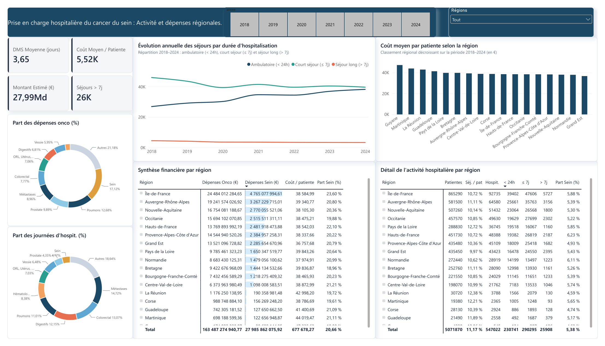
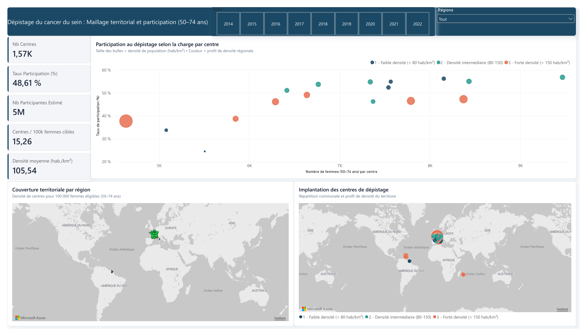
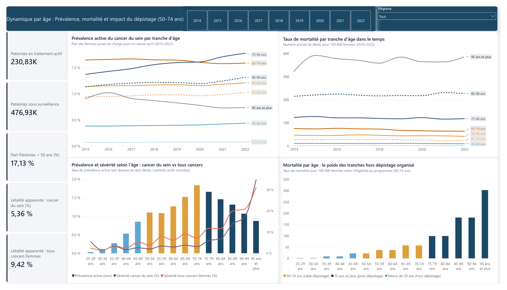
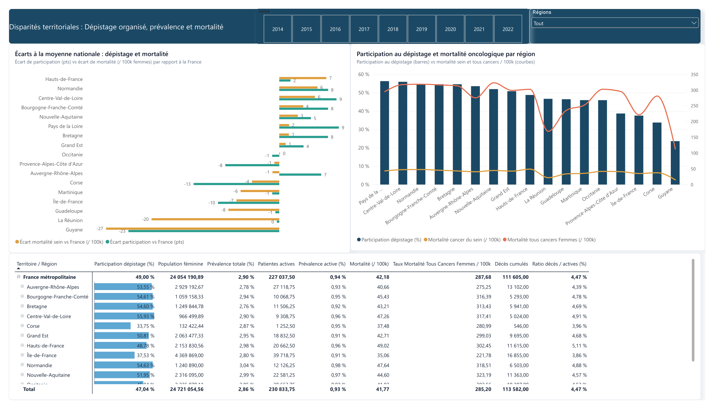

# 🎗️ Analyse décisionnelle du cancer du sein en France (2014–2024)

[](https://www.getdbt.com/)
[](https://cloud.google.com/bigquery)
[](https://powerbi.microsoft.com/)
[-3776AB?logo=python&logoColor=white)](https://www.python.org/)

Plateforme décisionnelle **end-to-end** (collecte Open Data en Python, modélisation **dbt Core** sur **Google BigQuery** en architecture Médaillon et restitution **Power BI** en schéma en étoile) dédiée à l'analyse épidémiologique, territoriale et médico-économique du cancer du sein en France sur la période **2014–2024**.

---

## 1. Contexte & Problématiques Santé Publique

En France, le cancer du sein demeure le premier cancer chez la femme tant en termes de fréquence que de mortalité. Malgré la généralisation du programme national de dépistage organisé (ciblant les femmes de **50 à 74 ans** tous les deux ans), le pilotage public fait face à trois enjeux majeurs autour desquels s'articule ce projet :

1. **Économie de la santé & charge hospitalière** : Comment se positionne le cancer du sein dans les dépenses et l'activité hospitalière de l'oncologie en France ? Quelle est l'ampleur du virage ambulatoire et de l'évolution des postes de dépenses (médicaments innovants, hospitalisations, soins de ville) ?
2. **Maillage territorial & participation au dépistage** : Avec une participation nationale qui plafonne autour de **48,6 %** (bien en deçà de l'objectif européen de 70 %), l'offre de centres de radiologie agréés suffit-elle à expliquer les écarts régionaux, ou existe-t-il des freins socio-démographiques et urbains ?
3. **Dynamique par âge, survie & disparités territoriales** : Comment évoluent la prévalence, la létalité apparente et la mortalité standardisée selon la tranche d'âge (avant, pendant et après la fenêtre de dépistage 50–74 ans) et selon les territoires (gradient Nord-Est et décrochage des DROM) ?

---

## 2. Architecture Data & Stack Technique

### Flux de données End-to-End

```text
┌──────────────────────────────────────────────────────────────────────────────┐
│ 1. SOURCES OPEN DATA OFFICIELLES                                             │
│    Cnam / Ameli • DREES (MCO) • Santé publique France • CépiDc • INSEE COG   │
└──────────────────────────────────────┬───────────────────────────────────────┘
                                       ▼
┌──────────────────────────────────────────────────────────────────────────────┐
│ 2. EXTRACTION & ENRICHISSEMENT PYTHON 3.13 (sources_python/, scripts_python/)│
│    • Appels API REST Open Data (Ameli / CépiDc / geo.api.gouv.fr)            │
│    • Parsing PDF de l'annuaire des centres de radiologie + dédoublonnage     │
└──────────────────────────────────────┬───────────────────────────────────────┘
                                       ▼
┌──────────────────────────────────────────────────────────────────────────────┐
│ 3. DATA WAREHOUSE GOOGLE BIGQUERY (cancer-du-sein-513216)                    │
│    Data_brute (données brutes) & Data_clean (référentiels pré-nettoyés)      │
└──────────────────────────────────────┬───────────────────────────────────────┘
                                       ▼
┌──────────────────────────────────────────────────────────────────────────────┐
│ 4. MODÉLISATION DBT CORE (45 modèles • 474 tests • persist_docs)             │
│    Staging (26 vues) ──► Intermediate (8 tables) ──► Marts Gold (11 tables)  │
│    stg_projet_cancer     int_projet_cancer          mart_projet_cancer       │
└──────────────────────────────────────┬───────────────────────────────────────┘
                                       ▼
┌──────────────────────────────────────────────────────────────────────────────┐
│ 5. BI & DATA VISUALISATION POWER BI (powerbi/)                               │
│    Modèle en étoile (DIM_regions, dim_tranches_age, DIM_annee ↔ Faits) + DAX │
└──────────────────────────────────────────────────────────────────────────────┘
```

### Schéma d'architecture Médaillon

- [Schéma d'architecture de synthèse](docs/architecture_medaillon_synthese.jpg)
- [Schéma d'architecture détaillé](docs/architecture_medaillon_detaillee.jpg)

### Détail des couches dbt (`models/`)

La macro [`macros/generate_schema_name.sql`](macros/generate_schema_name.sql) route chaque couche vers son dataset BigQuery dédié, avec persistance automatique des métadonnées et descriptions de colonnes dans BigQuery (`+persist_docs: relation: true, columns: true`) :

- **Couche `models/staging/` (`stg_projet_cancer` — 26 vues)** :
  - Standardisation stricte des schémas en `snake_case` et typage explicite (`INT64`, `FLOAT64`, `BOOL`).
  - Harmonisation des libellés régionaux hétérogènes entre institutions (`'Auvergne et Rhône-Alpes'` → `'Auvergne-Rhône-Alpes'`, `'Nouvelle Aquitaine'` → `'Nouvelle-Aquitaine'`, `'Centre-Val de Loire'` → `'Centre-Val-de-Loire'`) et codes INSEE à 2 caractères (`lpad(..., 2, '0')`).
  - Génération de clés primaires synthétiques SHA-256 (`to_hex(sha256(to_json_string(struct(...))))`) et déduplication défensive par `QUALIFY ROW_NUMBER() OVER (...) = 1`.
- **Couche `models/intermediate/` (`int_projet_cancer` — 8 tables Silver)** :
  - Croisement multi-sources et calcul des composantes brutes destinées aux agrégations DAX (numérateurs et dénominateurs sans biais de moyenne de ratios).
  - Inclut notamment `int_charge_hospitaliere_sein` (importée sous le nom `FACT_charge_hospitaliere_sein` dans Power BI) et `int_depenses_regionales_sein` (importée sous `FACT_depenses_regionales_sein`), `int_nb_centre_taux_depistage_region`, `int_carte_centres_depistage_ville`, `int_comparatif_sein_vs_tous_cancers`, `int_mortalite_territoriale_sein`, `int_impact_depistage_territoires` et `int_incidence_age_depistage`.
- **Couche `models/marts/` (`mart_projet_cancer` — 11 tables Gold)** :
  - **2 dimensions conformes** : `dim_regions` (18 régions, `code_iso_region` ISO 3166-2:FR, `zone_geographique`, `est_metropole`) et `dim_tranches_age` (15 tranches quinquennales de `25-29` à `95+`, seuil strict `est_cible_depistage` 50–74 ans, colonnes de tri natif).
  - **9 tables de faits prêtes pour Power BI** : `mart_oncologie_depenses_charge_region`, `mart_depenses_sein_postes_evolution`, `mart_depistage_centres_region`, `mart_carte_centres_ville`, `mart_comparatif_sein_vs_onco`, `mart_correlation_depistage_prevalence_mortalite_region`, `mart_correlation_age_region_sein`, `mart_mortalite_std_distribution_region` (standardisation directe France RP 2022 + tests de Friedman et Wilcoxon) et `mart_depistage_mortalite_delai_region` (analyse longitudinale avec décalage temporel `t - k` de 0 à 9 ans).
- **Qualité & Gouvernance** : **474 tests dbt** (`unique`, `not_null`, intégrité référentielle `relationships` vers `dim_regions` / `dim_tranches_age`, `accepted_values`) + tests singuliers (`tests/assert_stg_mortalite_region_quality.sql`).

### Arborescence du dépôt

```text
├── dbt_project.yml              # Configuration globale dbt & persist_docs
├── macros/                      # Macro generate_schema_name.sql
├── models/
│   ├── staging/                 # 26 vues Bronze + schema.yml & mortalite.yml
│   ├── intermediate/            # 8 tables Silver + schema.yml
│   └── marts/                   # 11 tables Gold (Dimensions + Marts) + schema.yml
├── tests/                       # Tests SQL singuliers de qualité
├── sources_python/              # Collecte API (Ameli, CépiDc, DREES) & parsing PDF radiologie
├── scripts_python/              # Notebooks d'analyse et de démonstration end-to-end
├── docs/                        # Schémas d'architecture & captures PNG HD Power BI
└── powerbi/                     # Classeur Power BI (.pbix) en modèle étoile
```

---

## 3. Enseignements Clés & Aperçu des 4 Dashboards Power BI

> **Accès aux livrables BI :** [Classeur Power BI (`Projet Cancer du sein.pbix`)](powerbi/Projet%20Cancer%20du%20sein.pbix) • [Export PDF haute définition (`Projet Cancer du sein.pdf`)](docs/Projet%20Cancer%20du%20sein.pdf)

### 1. Prise en charge hospitalière & dépenses régionales (2018–2024)
Le cancer du sein illustre un paradoxe médico-économique majeur : il concentre **20,66 % des dépenses oncologiques** (~28 Md€ cumulés sur la période), mais ne représente que **5,38 % des journées d'hospitalisation**. Ce découplage s'explique par un **virage ambulatoire massif** (séjours `< 24h` pour chirurgie ambulatoire, chimiothérapie et radiothérapie) et une durée moyenne de séjour courte (**DMS de 3,65 jours**). À l'inverse, l'analyse par poste montre que les **médicaments** (ville et liste en sus MCO) constituent le principal moteur inflationniste (**+137,0 %** entre 2015 et 2024).



### 2. Dépistage organisé & maillage territorial (50–74 ans)
Sur les **1 570 centres agréés** recensés en France (densité moyenne de **15,26 centres pour 100 000 femmes cibles**), le maillage brut ne garantit pas mécaniquement la participation. On observe une sous-performance notable de zones pourtant très denses comme l'**Île-de-France (-10 pts)** ou **PACA (-8 pts)** par rapport à la moyenne nationale (~48,6 %), traduisant des phénomènes de saturation des rendez-vous, de recours au dépistage individuel hors programme et d'inégalités d'accès socio-territoriales.



### 3. Dynamique par âge & comparatif Tous Cancers
Grâce au dépistage et aux progrès thérapeutiques, la létalité apparente annuelle du cancer du sein (**5,36 %** — ratio décès / patientes actives) est près de deux fois inférieure à celle de l'ensemble des cancers féminins (**9,42 %**). L'analyse par tranche d'âge met toutefois en lumière deux angles morts hors de la cible réglementaire 50–74 ans : **50,11 % des décès** surviennent chez les femmes de **75 ans et plus**, tandis que **17,13 % des patientes en prise en charge active** ont **moins de 50 ans** (hors dépistage organisé).



### 4. Disparités territoriales & gradient Nord-Est / Outre-mer
En neutralisant l'effet structure d'âge par standardisation directe (population de référence France RP 2022), les écarts régionaux sont hautement significatifs (test global de Friedman : `χ² = 98,33`, `p = 1,81 × 10⁻¹³`). Le **Nord-Est** (Hauts-de-France, Normandie, Grand Est) présente une **surmortalité persistante** malgré une forte participation au dépistage organisé (effet de cohorte, facteurs environnementaux et socio-économiques). À l'opposé, les territoires d'**Outre-mer** enregistrent un net décrochage du dépistage (jusqu'à **-23 pts en Guyane**), dont l'impact sur la mortalité brute est partiellement masqué par une structure démographique plus jeune.



---

## 4. Hypothèses & Limites Méthodologiques

- **Regionalisation des dépenses (`int_depenses_regionales_sein`)** : Les données financières de l'Assurance Maladie (Cartographie des pathologies) n'étant publiées qu'à l'échelon national, les dépenses régionales sont estimées par pondération (`effectifs régionaux × coût moyen national par patiente`), appliquée **séparément** pour les patientes en phase active et sous surveillance.
- **Périmètre Cnam & secret statistique** : La cartographie Ameli capte les patientes prises en charge (notamment via ALD ou soins traceurs), ce qui peut légèrement sous-estimer certaines formes très précoces ou suivis hors régime général ; les effectifs inférieurs à 11 patientes à la maille fine `région × tranche d'âge` sont masqués par secret statistique (`NULL` / `0`).
- **Ventilation démographique des décès CépiDc** : Les effectifs régionaux de mortalité CépiDc étant diffusés par tranches d'âge décennales (`45-54`, `55-64`, `65-74`...), la reconstitution en tranches quinquennales alignées sur Ameli/INSEE (`50-54`, etc.) repose sur un prorata démographique INSEE féminin exact par région et année.
- **Inertie épidémiologique & approche observationnelle** : L'effet protecteur du dépistage organisé sur la mortalité s'exerce avec un décalage de **5 à 10 ans** (`mart_depistage_mortalite_delai_region` teste les lags `t-0` à `t-9`), tout en restant une analyse observationnelle exposée aux biais écologiques et aux facteurs confondants territoriaux.
- **Inventaire statique des centres de radiologie** : L'annuaire PDF des centres ne comportant pas de dates historiques d'ouverture/fermeture, le maillage constitue une photographie statique (millésime 2022–2023) projetée sur l'historique régional pour les comparaisons temporelles.

---

## 5. Guide de Reproduction en Local

### 1. Cloner le dépôt et installer l'environnement Python
```powershell
git clone https://github.com/Hythus/dbt-bigquery-analyse-cancer-du-sein.git
cd dbt-bigquery-analyse-cancer-du-sein

python -m venv .venv
.\.venv\Scripts\Activate.ps1
pip install dbt-core dbt-bigquery pandas requests google-cloud-bigquery pdfplumber
```

### 2. Configurer l'authentification BigQuery et le profil dbt
Définissez votre clé de compte de service GCP (ou utilisez `gcloud auth application-default login`) sans jamais la placer dans le dépôt :
```powershell
$env:GOOGLE_APPLICATION_CREDENTIALS="C:\chemin\securise\votre-cle-service-account.json"
```

Exemple de configuration `~/.dbt/profiles.yml` :
```yaml
mon_projet:
  target: dev
  outputs:
    dev:
      type: bigquery
      method: service-account
      project: cancer-du-sein-513216
      dataset: stg_projet_cancer
      threads: 4
      keyfile: "{{ env_var('GOOGLE_APPLICATION_CREDENTIALS') }}"
      location: EU
```

### 3. Tester la connexion et exécuter la pipeline dbt
```powershell
# Vérifier la connexion BigQuery et la validité du projet
dbt debug

# Construire les modèles et exécuter l'intégralité des 474 tests de qualité
dbt build
```

---

## 6. Auteur

**Valentin Devalckeneer** — *Data Analyst / Analytics Engineer*  
Projet de fin de cursus **DataBird** — Novembre 2026  
Dépôt GitHub : [Hythus/dbt-bigquery-analyse-cancer-du-sein](https://github.com/Hythus/dbt-bigquery-analyse-cancer-du-sein)
